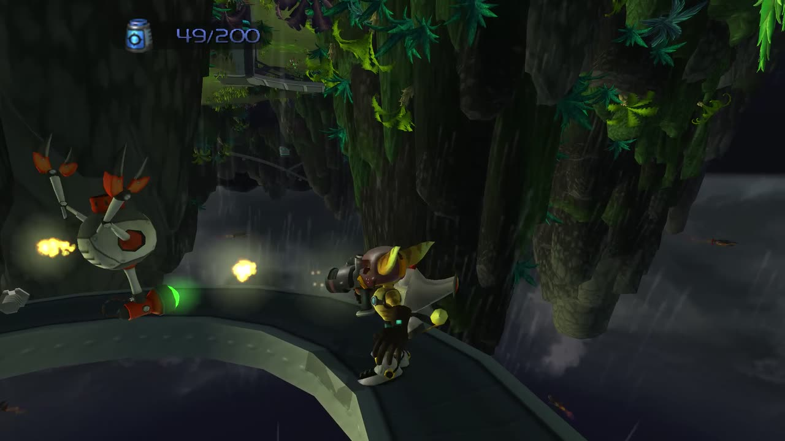

# Going Commando Magneboots

A native mod for [OpenRAC](https://github.com/OpenRAC/OpenRAC)'s port of Ratchet & Clank: Going
Commando's **Gravity Boots** in place of the **Magneboots**. On magnetic surfaces Ratchet walks,
runs, jumps and fights as on any ground, and a jump, a double jump or a step off an edge comes back
down onto the surface. The item keeps its name.

[](https://youtu.be/TKqdbXuQDlA)

*▶ [Watch it on YouTube](https://youtu.be/TKqdbXuQDlA) (14 s, with sound).*

In Ratchet & Clank the Magneboots have a slow magnet walk of their own (state 0x3F): about 3.5 units
a second, a stop to turn when the stick points more than 70 degrees away, X as a hop on the spot,
weapons and quick select locked, and the surface let go of 0.3 units off it. Going Commando has none
of that: its magnetic surfaces are plain ground with their own gravity.

**Needs OpenRAC with mod interface 1.22 or later**, for three hook points it brought
(`rac1.player.enter_move_state`, `rac1.player.resolve_gravity_mode`,
`rac1.player.update_equipped_items`, OpenRAC #590). Until a release has it, that is the launcher's
**Dev** update channel (Settings); the launcher holds the mod back on an older one rather than
install something that cannot load. It is built against the SDK's source at a commit of OpenRAC's
`develop` (`sdk.lock`), back to a released SDK once there is one.

## How it works

Everything that makes the magnet walk hangs on one flag, the hero's "held by the Magneboots"
(`Hero.unk308`). The mod:

- **turns the magnet walk and the hop into the run and the jump** as his state machine asks for
  them (`enter_move_state`, the flag hidden from the state change);
- **unlocks his items** (`update_equipped_items`, the flag hidden from it);
- **gives his gravity Going Commando's rule** (`resolve_gravity_mode`): the surface's while a
  magnetic surface is within 2.5 units under him, and on through the air off it, with its normal
  remembered, until he lands or 1.5 seconds have gone by;
- leaves the flag to his collision, which uses it to let him walk from the floor up a magnetic wall.

## Build

```sh
python3 tools/fetch_sdk.py          # the SDK sdk.lock pins, into .sdk/
cmake -S . -B build -G Ninja
cmake --build build && ctest --test-dir build
python3 .sdk/openrac-mod-sdk-*/tools/package_mod.py build/package/gc_magneboots
```

## License

MIT.
